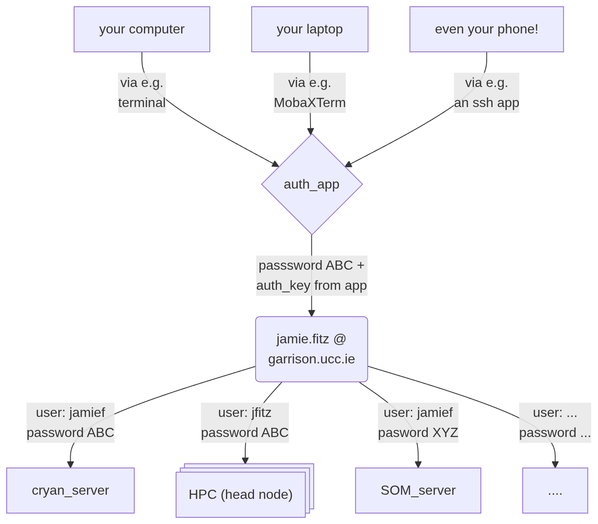
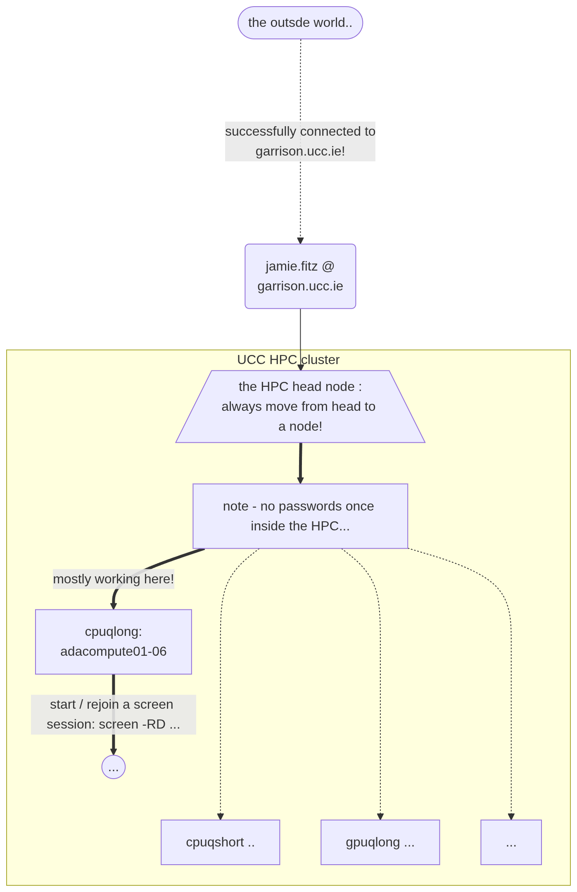

 
```{r set_opts, include=FALSE}
knitr::opts_chunk$set(
  eval = FALSE
)
```

---

## Connecting the dots
 
Everything starts somewhere, and we start here! You will need:

  - a computer
  - on that computer, an **`ssh client`**
  - a reasonable internet connection
  - an account (username, password, verification app) on garrison (just passing through)
  - an account (username, password) on the computer you want to connect to (usually the HPC)
  - some data, some objectives, hypothesis etc.
  
Hopefully the guide below should help with orientation. If not, [suggestions go here](https://github.com/handibles/handibles.github.io/issues)
  
<br>

## what programme to use

To be decided / explored, but for some quick web-based suggestions for `ssh` connections on _Windows_, click the arrow: 
<details>
<summary> check: </summary>

  - [**Windows terminal**](https://learn.microsoft.com/en-us/windows-server/administration/openssh/openssh_install_firstuse?tabs=gui&pivots=windows-server-2025) (windows 11+) - finally bringing windows up to the mac/linux level for basic functionality. If it's there, give it a go (it's free), but maybe check out a quick guide on [youtube](https://www.youtube.com/results?search_query=beginners+guide+ssh+windows+terminal) or face Microsoft [documentation.](https://en.wikipedia.org/wiki/Heat_death_of_the_universe)
  - [**solar-putty**](https://www.solarwinds.com/free-tools/solar-putty) - an expansion of the popular, robust, but simple client (putty). Apparently good and also free. 
  - [**MobaXTerm**](https://mobaxterm.mobatek.net) - should do all the things we need, especially sending/receiving files more easily. Also free.
</details>
  
<br>

## Quick guide:

Details aren't given here, but the four steps are: 

```{bash, eval = FALSE}

# 0th step: do check that you have internet access...

# 1st step: connect to garrison
  - need garrison password
  - need authentication code

# 2nd step: connect from garrison to your cluster's *head* node
  - need cluster password

# 3rd step: connect from cluster's head, to a *compute* node
  - dont need a password, but still use ssh 

```

Authentication code should be via your phone ; passwords will have been set by you, and might be the same for garrison and cluster.


<br>

## 1st Step

The network is partitioned separately from the Internet to make sure that no-one's hard drive fills up or is late for work. To enter, we connect to `garrison`, which allows us connect to computers within the university. 

To cross the network to `garrison`, use your computer's `terminal` or `ssh` window (e.g. `terminal` in OSX/linux, `powershell` in WinOS, or separate programmes like `MobaXTerm`, `WinSCP`, `fileZilla`, `putty`, etc.) to the server where you do your work.

<br>

Any of these ways work - use whatever suits you best: 

```{r eval=TRUE, garrison_in, echo=FALSE, fig.cap="connecting to the college network (from anywhere)", out.width = '90%'}

```

<br>


## 2nd Step 

The _HPC_ is partitioned from rest of the network so that people don't use it too much. 

```{r eval=TRUE, hpc_in, echo=FALSE, fig.cap="connecting to the HPC server", out.width = '90%'}

```


## 3rd Step


## speed things up

Now that you know how to connect, there are some ways to speed things up. Very not necessary.

  - connect with a single command: set an alias in `bash` (linux) or `zsh` (mac), or in `powershell` (windows)
  - connect garrison-HPC without a password - get the HPC to "trust" your garrison account and allow direct login - `ssh-copy-id`
  
