<!-- what is it about the remaining human sequences that makes them so difficult to remove / evade Deacon? Does BT2 miss the same things? Cool project q. -->

<!-- UPDATE THE CODE-ONLY  -->


```{r set_opts, include=FALSE}
knitr::opts_chunk$set(
  eval = FALSE
)
```

<!-- > **should we decontam before everything else?** -->

<!-- Should we process tihngs separately? easy to do for overlord, but at this point? -->

<!-- consider also Kaiju & CCMetagen & the LLM revolution. Metaphlan, you stay in the bin Metaphlan. Could easily be made into a pipeline script. -->

---

###  [ ↞ home ](https://handibles.github.io) |  [ ↑ server access ](https://handibles.github.io/documents/approacher.html) | [ ↑ troubleshooting ](https://handibles.github.io/documents/troubleshooting.html) | [ ⭬ `code only` ](https://handibles.github.io/analysis/climber_justthecode.sh)

---

## hello

This is a quick, simplified guide to processing large shotgun short-read sequencing datasets. Please forward bugs/suggestions/typos [here](https://github.com/handibles/handibles.github.io/issues). 

Note the table of contents on the left side of the page.

    <!-- `0.` setup and configure  -  installing programmes and databases -->
    <!-- `1.` download        (and check) -->
    <!-- `2.` trimm           (and check) -->
    <!-- `3.` decontaminate   (and check) -->
    <!-- `4.` identify        (and check) -->
    
<br> 

> NB: the guides is fully written, but parts will continue to be updated. 

      
<br>

## 0. setup & configure

### crucial first step! 

First, start a `screen` session. As well as other fancy stuff, `screen` keeps your stuff running, even if you get disconnected / crash your computer etc. You can keep coming back to this window and continue your work. 

```{bash start_screen}
# start (or reconnect to) a stable screen session called "femmebio"
screen -RD femmebio

# to disconnect, press Ctrl+A, and then D (or just close the window)
```

    
### folders etc. 

A type of nick-name called a `local variable` will help us keep things tidy. First, give a nickname like `mywork` to the folder location (also called a `path`) where you want to do your work - now, we can use that short nickname to refer to that location anywhere in our script, by adding `$` to the variable: `$mywork`. 

If our folder path ever changes (e.g. use the same code for a different project), we only need to update what location we link to that nickname - the nickname itself can stay the same. Much easier to read, copy, remember, and type.

<br>

> update! 

For this project, we have been given a big (3TB) central folder to keep our work in - `/projects/FMH/2026_EUmetriosis/`. For now, as an example, lets arrange things like this (but we should decide this together):

<!-- ```{bash eum_tree} -->
<!-- # handy tool to print the directory structure ::  mamba install tree -y -->
<!-- tree /projects/FMH/2026_EUmetriosis/ -->
<!-- ``` -->

```
/projects/FMH/2026_EUmetriosis
├── user1
├── user3
├── user007
└── rawdata_readonly    # raw data goes in here and is not altered.
  
```  
  
```{bash local_variables}
# should match your ID on HPC/server/garrison
self=cleverusername

# pick a fancyname
proj=myproject

# use $self from above to define your working directory
mywork=/projects/FMH/2026_EUmetriosis/

## check them - if the $var doesnt exist they'll print empty
echo $self $proj $mywork $thisdoesntexist

# beware of undefined (empty) vars, and vars assigned to typos/nonsense/outdated data
# computer doesn't know the difference. yet.

```

<br> 

First, save each folder name as a `local variable`, then pass those `local variables` to `mkdir` to _make_ those folders _real_.  

```{bash secret_vars, echo=FALSE, eval=FALSE }
# the actual variables used but hidden in the output HTML:
self=EXT05188
proj=ucc__fbio
mywork=/home/$self
```

```{bash folder_vars }
# using mywork from above
raw=$mywork/raws/${proj}__raw
join=$mywork/raws/${proj}__join
wrk=$mywork/work/$proj

# for storing metadata etc.
mat=$wrk/Materials

# assumed location, update as necess
db=$mywork/db   

qc=$wrk/1__qc

filt=$wrk/2__filt
host=$wrk/3__deacon
krak=$wrk/4__krak2

## make folders from vars
mkdir -p $raw $join $wrk $qc $filt $host $krak $mat
mkdir -p $qc/${proj}_join $qc/${proj}_filt  $qc/${proj}_host $qc/${proj}_join_multi $qc/${proj}_filt_multi $qc/${proj}_host_multi

```

<br> 

### programmes etc. 

<details>
<summary> Click **here** for installation stuff - you might only ever have to do it once.</summary>
<br>

`mamba` (i.e. a quicker version of `conda`) is your new best friend.

```{bash setup_and_config__mamba}

# folder for your programmes - adapt as best suits you
b_path=~/bin  
mkdir -p $b_path ; cd $b_path

# first, get mamba (miniforge) and run through installation
wget "https://github.com/conda-forge/miniforge/releases/latest/download/Miniforge3-$(uname)-$(uname -m).sh"
bash Miniforge3-$(uname)-$(uname -m).sh

# install tools needed into fresh environments using mamba. or dont.
mamba create -n mgx -c bioconda -c conda-forge trimmomatic fastqc multiqc deacon -y   # 346MB
mamba create -n k2 -c bioconda bracken kraken2 krakentools parallel -y # >300MB

# while here, get KrakenTools for later
git clone https://github.com/jenniferlu717/KrakenTools.git
```


We can also write our own (simple!) programmes - this one compares samples in a folder against a sample list, and reports back any missing samples:

```{bash custom_fns}

catcher (){
  
  local DirCheck=$1
  
  # -23 : suppress files present in DirCheck / common to both - show just missing samples from samplelist
  comm -23 \
    <( sort $mat/${proj}__samples.txt ) \
    <( ls $DirCheck | sed -E 's/_(S[0-9]*).*/_\1/g' | sort  -u)

}

# e.g. check samples downloaded (should return nothing!)
catcher $join

# e.g. check samples filtered (might return something...)
catcher $filt

```


Most programmes have resources they need to get - time to get the ones you need (only need to get them once). 

```{bash setup_and_config__databases}

# filtering & trimming - trimmomatic standard reference sequences to be removed
echo '>Ampli_Tru_Seq_adapter__MOST_IMPORTANT_FEEEL_ME
CTGTCTCTTATACACATCT
>Transposase_Adap__for_tagmentation_1
TCGTCGGCAGCGTCAGATGTGTATAAGAGACAG
>Transposase_Adap__for_tagmentation_2
GTCTCGTGGGCTCGGAGATGTGTATAAGAGACAG
>PCR_primer_index_1
CAAGCAGAAGACGGCATACGAGATNNNNNNNGTCTCGTGGGCTCGG
>PCR_primer_index_2
AATGATACGGCGACCACCGAGATCTACACNNNNNTCGTCGGCAGCGTC
>TruSeq_single_index_LT_CD_HT__1
AGATCGGAAGAGCACACGTCTGAACTCCAGTCA
>TruSeq_single_index_LT_CD_HT__2
AGATCGGAAGAGCGTCGTGTAGGGAAAGAGTGT
>PCR-Free_Prep__Tagm__additional_seq
ATGTGTATAAGAGACA
>Ampli_Tru_Seq_adapter__MOST_IMPORTANT_FEEEL_ME__mate_RC
AGATGTGTATAAGAGACAG
>Transposase_Adap__for_tagmentation_1.RC:
CTGTCTCTTATACACATCTGACGCTGCCGACGA
>Transposase_Adap__for_tagmentation_2.RC:
CTGTCTCTTATACACATCTCCGAGCCCACGAGAC
>PCR_primer_index_1_RC:
CCGAGCCCACGAGACNNNNNNNATCTCGTATGCCGTCTTCTGCTTG
>PCR_primer_index_2_RC:
GACGCTGCCGACGANNNNNGTGTAGATCTCGGTGGTCGCCGTATCATT
>TruSeq_single_index_LT_CD_HT__1_RC:
TGACTGGAGTTCAGACGTGTGCTCTTCCGATCT
>TruSeq_single_index_LT_CD_HT__2_RC:
ACACTCTTTCCCTACACGACGCTCTTCCGATCT
>PCR-Free_Prep__Tagm__additional_seq_RC:
TGTCTCTTATACACAT
>polG_just_from_PCF_concerns
GGGGGGGGGGGGGGGGGGGGGGGG
>polA_just_from_PCF_concerns
AAAAAAAAAAAAAAAAAAAAAAAA'> $mat/fqc_trimmo_ill_ref.fa


## more commonly, oprogrammes need databases: recall we defined a $db var for this.
lk $db


# decontamination - Download validated 3GB human pangenome index (version 0.13.0 or later)
deacon index fetch panhuman-1 -o $db/deacon_db
```

<br> 

`Kraken2` uses a database of {k-mer} patterns in different microbes, and compares these patterns against those seen in your reads. `Bracken` (a post-hoc for `Kraken2`) uses a portion of this same database to estimate community composition. Building these databases is ideal, but can be a challenge - [Ben Langmead's research group host pre-made versions of many databases](https://benlangmead.github.io/aws-indexes/k2), assuming that you want to use their pre-decided read-lengths. Here, we go for the `125bp` versions with the PlusPF database - but be aware that it's `+100GB` of data, so it will take a while to download. Ideally, there would only be a single copy on the server - but for now we will download our own. 


```{bash krak_db}
## assignment - kraken2 / Bracken
cd $db
wget https://genome-idx.s3.amazonaws.com/kraken/k2_pluspf_20260226.tar.gz

## -Xtract Ze Vucking Files (extract, gzipped, verbose, file-destination: )
tar -xzvf $db/kraken2_plusPF__langmead $db/k2_pluspf_20260226.tar.gz

## look
ls -lsh $db/kraken2_plusPF__langmead
```

Non-`mamba`: install `basespace` from illumina, for getting sequence data: firstly, get an Illumina account [here](https://login.illumina.com).

```
## record your own username and password as best you see fit:
> u: _____________
> p: _____________
```
Then get and activate the `bs`:

```{bash setup_and_config__bs }

bs=$b_path/bs

## if you don't have it, download the basepspace programme (aka bs) to $bs :
wget "https://launch.basespace.illumina.com/CLI/latest/amd64-linux/bs" -O $bs ; chmod 775 $bs

# follow instructions to complete setup:
$bs auth
# more info if you like: (press Q to exit)
$bs download -h

```

Hoo. Nearly there.

</details>

<br>

**NB:** In reality, if we're running these programmes on UCC's HPC cluster, we will have to change the format for these commands to work with a HPC management programme called `SLURM`. We'll cover this later, but for the moment any `SLURM` work will go into a drop-down box like the one below - **ignore these for now**.


<br>

### final crucial prep! 

Last thing - because we used `mamba` to install our programmes above into the `mgx` environment, we need to "activate" the `mgx` environment before use or the computer will think the programmes are not installed. 

```{bash activate_mamba}
mamba activate mgx

## to deactivate it afterwards
# mamba deactivate

```

Time to go. 

<br> 

---

## 1. download (& check) - `bs` + `fastqc`

Basespace (aka `bs`) should have been installed & authenticated above. Now, follow the basespace link sent to you by your sequencer - it will add the data to your illumina account (which should also have been set up above).

> `https://basespace.illumina.com/s/abcdefghijkl      # not a real link!`

When you click the above it will bring you to a webpage - the **project ID for download is in that page's URL address** e.g. : 

> `https://basespace.illumina.com/projects/123456789/about`

, where **`123456789`** is the project ID. Mad I know. 

```{bash bs_get}
# save your real project ID here
projectID=123456789

## download FASTQ to the folder we chose/created above - will take a while to finish (screen will protect us)
$bs download project --id $projectID --output $raw --log=$f_path/fdl.log & 


## have a lük: red = compressed
ls $raw/*/*gz
# use that to pull a sample list for constant re-use. always worth doublechecking.
ls $raw/*/*gz | sed -r 's/.*\/(.*)_L00._R._001.fastq.gz/\1/g' | sort -u > $mat/${proj}__samples.txt
head -n 10 $mat/${proj}__samples.txt
  
##  tidy up - join lanes (L001, L002) and remove _L00*_R*_001 from name. 
time parallel -j 16 "cat $raw/*/{}_L00*_R1_001.fastq.gz >  ${join}/{}_R1.fastq.gz ; cat $raw/*/{}_L00*_R2_001.fastq.gz >  ${join}/{}_R2.fastq.gz" :::: $mat/${proj}__samples.txt


```

<br>

### Check the sequencing output

[`FastQC`](https://www.bioinformatics.babraham.ac.uk/projects/fastqc/) checks each sample and generates a report you can read ; [`MultiQC`](https://docs.seqera.io/multiqc) combines multiple reports together.

```{bash dl_check }

fastqc -t 15 $join/*fastq.gz -o $qc/${proj}_join

```


Once `FastQC` has finished running, collate those reports:

```{bash multiqc }
multiqc $qc/${proj}_join -o $qc/${proj}_join_multi

```

<details>
<summary> `SLURM` version + fiddling </summary>


`SLURM` guidance can be sought [here](https://hpc.nmsu.edu/discovery/slurm/commands/) and across the webs. 

Make a new script file:

```{bash slurm_fqc__INCOMPLETE1}
nano $mat/${proj}__slurm__fqc20.sh
```

 -and add these (simplified) lines

```{bash slurm_fqc__INCOMPLETE2}
#!/bin/bash

#SBATCH --job-name=fqc20
#SBATCH --output=omm__1__fqc20.%j.slrm
#SBATCH --ntasks=20
#SBATCH --time=0-1:30:00

INPATH=$1
OUTPAT=$2
FQC_PROCS=$3

fastqc -t $FQC_PROCS ${INPATH}/*fastq.gz -o $OUTPAT

mkdir -p $OUTPAT/fwd $OUTPAT/rev ${OUTPAT}_multi
mv $OUTPAT/*R1* $OUTPAT/fwd/
mv $OUTPAT/*R2* $OUTPAT/rev/

multiqc $OUTPAT/fwd -o ${OUTPAT}_multi/multi_fwd
multiqc $OUTPAT/rev -o ${OUTPAT}_multi/multi_rev

```

```{bash fqc_slurm_go}

# simple issue 
sbatch $mat/${proj}__slurm__fqc20.sh $join $qc/${proj}_join 20

```

</details>

<br>

Now to see how that looks. Copy the `multiQC.html` output to your computer and have a look:

```{bash slurm_fqc_local}

# XXX.YYY.34.1 is the address for the HPC (replace XXX.YYY with our real prefix) - we use -o ProxyJump to send the request through garrison.ucc.ie

# run this command on the server (to get the correct paths etc.), then copy and paste on your local (UNIX) machine
echo "scp -o ProxyJump=${self}@garrison.ucc.ie ${self}@XXX.YYY.34.1:$qc/${proj}_join_multi/multiqc_report.html ./Desktop/"

# in your browser, open the `multiqc_report.html` that has appeared on your desktop 

```

<br>

Lots of info. Focus on `Per Base Sequence Content`, clicking through a few different samples. 

```{r eval=TRUE, pbsqual, echo=FALSE, fig.cap="per base sequence quality", out.width = '90%'}
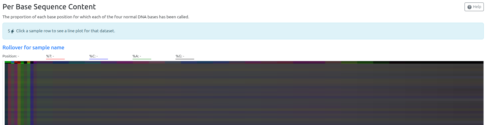
```

<details>
<summary> Click the drop-down for an overview of the MultiQC output.</summary>

Considering the `faec` & `vag` samples come from very different substrates, these look v comparable - probably because we haven't remove the host DNA yet. The smooth lines indicate regions where the overall sampling of communtiy DNA is so balanced that the lines separate reliably along the difference in DNA `GC` content (a characteristic of each sample - usually 40-60%). this is good! Note how things start and end badly though - **we always trim the beginning and end.**


```{r eval=TRUE, faec_plot, echo=FALSE, fig.cap="faecal sample", out.width = '90%'}
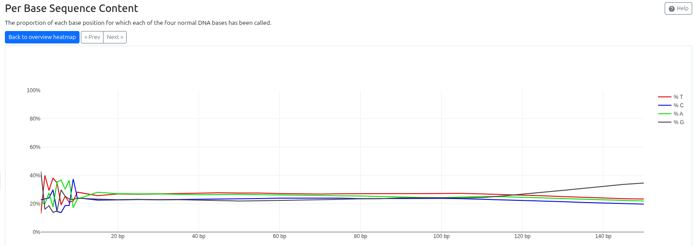
```

```{r eval=TRUE, vag_plot, echo=FALSE, fig.cap="vaginal sample", out.width = '90%'}
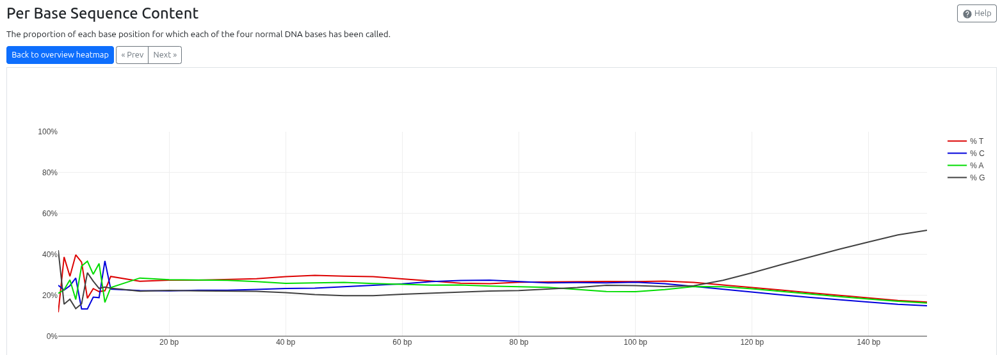
```

<br>

These are more jagged, more erratic - this indicates different bases are spiking up and down because there are so few reads, you're not getting a balanced sample across all positions. This is particulalrly evident at the `5'` (start) of the read: each read starts with a synthetic adapter, all of which have the same sequence. As a result, the bases at those locations are clearly `A, T, G,` or `C`.

Note that a negative control _should_look like this - the less DNA in the negative control the better! 

```{r eval=TRUE, bad_faec_plot, echo=FALSE, fig.cap="Vaginal-bad", out.width = '90%'}
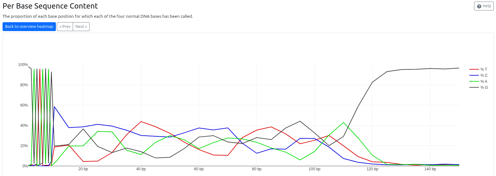
```

However, this is a vaginal sample that did not perform well (likely low yield). Something to be aware of.

```{r eval=TRUE, ctrl_plot, echo=FALSE, fig.cap="control sample", out.width = '90%'}
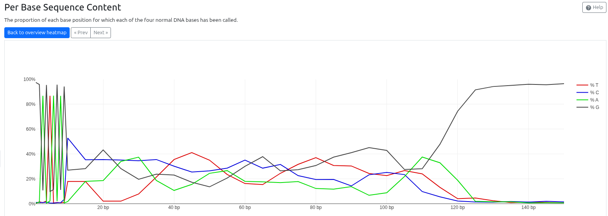
```

---

Finally, this is what the `trimmomatic` step is combating - adapter content (synthetic DNA sequences used to tie the sample to the machine chip). These will interfere at every stage of the analysis if not removed, so always check it. Note also there are two different trends here - one where the adapter content starts at 30(!)bp, and one where it starts at 100bp. Can you guess why?

```{r eval=TRUE, adapter_cont, echo=FALSE, fig.cap="adapter removal", out.width = '90%'}
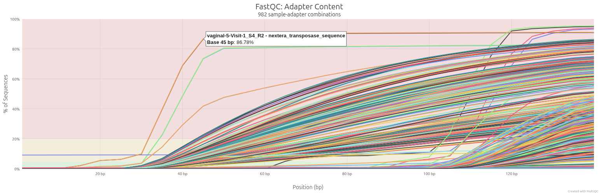
```

</details>

<br> 


After clicking through a few samples, you'll get a feel for where the 'kinks'/changes/wobbles in the read-quality are (at beginning and end). Here, I think `20bp` (on the 5\' / start) and `105bp` (on the 3\' / end). This means we're _throwing away more than a third of our data_, before we even start. Brave face.

Additionally, although trimming requirements are equivalent at the moment, it might make sense to **process the faecal and vaginal samples separately**. We can come back to this as necessary.

<br>


### choose test samples

Looking at all samples together is informative, but it takes a long time to test & run. 

Instead of testing this on all +300 samples, lets choose a practice subset (faster, easier, lighter workload). As a representative sample, taking all samples from `volunteer 23` (vaginal and faecal, 2 timepoints each) - this means 4 sample IDs (so `4 X (R1 + R2) = 8` `fastq` files in total). 

```{bash tester_get}
# grep looks for the pattern "23-V" in $mat/${proj}__samples.txt and returns those lines, we send it to a new file with ">"
grep "23-V" $mat/${proj}__samples.txt > $mat/${proj}__tester.txt

# have a little lük, its just the sample IDs
head $mat/${proj}__tester.txt

# and a test sample (just take the first one)
test=$( head -n 1 $mat/${proj}__tester.txt)

```

<br> 


## 2. trim and filter sequences (& check) - `trimmomatic`

Run [`trimmomatic`](http://www.usadellab.org/cms/uploads/supplementary/Trimmomatic/TrimmomaticManual_V0.32.pdf), then QC the outputs:

```{bash basic_trimmo }
  
##--< ! >   MAKE SURE you check F+MQC  to set your parameters below     < ! >--

# use ILLUMINACLIP before CROP to maximise space for pattern recognition
cat $mat/${proj}__tester.txt | parallel -j 4 "trimmomatic PE \
  $join/{}_R1.fastq.gz \
  $join/{}_R2.fastq.gz \
  $filt/{}_R1_trimm.fastq.gz \
  $filt/{}_R1_trimm_unpaired.fastq.gz \
  $filt/{}_R2_trimm.fastq.gz \
  $filt/{}_R2_trimm_unpaired.fastq.gz \
  ILLUMINACLIP:$mat/fqc_trimmo_ill_ref.fa:2:30:10:5 \
  SLIDINGWINDOW:6:15 \
  CROP:105 \
  HEADCROP:19 \
  MINLEN:50 \
  -validatePairs \ 
  -threads 4 > $filt/{}_trim.log 2>&1"
  
```


<details>
<summary> `SLURM` version of `trimmomatic` </summary>

Write the `SLURM` script:
```{bash write_slurm_trimmo}
nano $mat/${proj}__slurm__trimmo4.sh 
```

In it, place:

```{bash slurm_trimmo}
#!/bin/bash

#SBATCH --job-name=trimmo4
#SBATCH --output=omm__2__trimmo4.%j.slrm
#SBATCH --time=0-00:30:00
#SBATCH --ntasks=4


sl_samp=$1
sl_indir=$2
sl_outdir=$3

source /home/EXT05188/bin/miniforge3/etc/profile.d/conda.sh
conda activate geno

# sl_samp=$test   # choose a sample ID for testing on
# sl_indir=$raw
# sl_outdir=$filt
# echo $sl_samp $sl_indir $sl_outdir ${sl_outdir%\/*}


##--< ! >   MAKE SURE you check F+MQC  to set your parameters below     < ! >--

trimmomatic PE \
  $sl_indir/${sl_samp}_R1.fastq.gz \
  $sl_indir/${sl_samp}_R2.fastq.gz \
  $sl_outdir/${sl_samp}_R1_trimm.fastq.gz \
  $sl_outdir/${sl_samp}_R1_trimm_unpaired.fastq.gz \
  $sl_outdir/${sl_samp}_R2_trimm.fastq.gz \
  $sl_outdir/${sl_samp}_R2_trimm_unpaired.fastq.gz \
  ILLUMINACLIP:${sl_outdir%\/*}/Materials/fqc_trimmo_ill_ref.fa:2:30:10:5 \
  SLIDINGWINDOW:6:15 \
  CROP:105 \
  HEADCROP:20 \
  MINLEN:50 \
  -threads 4
  
# presume logged to trimmo4.%j.slrm
```

Run the `SLURM` script:

```{bash sbatch_trimmo}

# CHECK THE CROP VALUES (105, 20, 50), then insert the script above:
nano $mat/${proj}__slurm__trimmo4.sh 

## separate processing? note you abandon the neg ctrls here - do you really want to do this?
# grep "faecal" $mat/${proj}__samples.txt > $mat/${proj}__samples-faecal.txt
# grep "vaginal" $mat/${proj}__samples.txt > $mat/${proj}__samples-vaginal.txt

# for f in $( cat $mat/${proj}__tester.txt ) ; 
for f in $( cat $mat/${proj}__samples.txt ) ; 
do 
  sbatch $mat/${proj}__slurm__trimmo4.sh $f $join $filt ; 
done


```


Note, if something goes wrong or we need to re-fire some of the samples, we can use `SLURM` with the `catcher` function we wrote above (see the "_programmes etc._" drop-down box) to call out missing samples, and re-submit them to run:

```{bash trimm_refire_catcher}
for f in $( catcher $filt ) ; 
do 
  sbatch $mat/${proj}__slurm__trimmo4.sh $f $join $filt ; 
done
```

</details>

<br>

A **crucial** step is to check the output from `trimmomatic`, looking at the forward and reverse outputs separately to see how trimming has affected them. This is especially true when you have more than one sample type (e.g. faecal & vaginal), and also when you have challenging sample types (vaginal). 

Luckily, we can use the same `FQC/MQC` code that we wrote above, and simply change the files we want to check:

```{bash trimmo_fqc}
# remove unpaired stuff
mkdir $filt/unpaired ; mv $filt/*unpaired* $filt/unpaired/

# 
fastqc -t 16 $filt/*_trimm.fastq.gz -o $qc/${proj}_filt ; multiqc $qc/${proj}_filt -o $qc/${proj}_filt_multi

```

<details>
<summary> `SLURM` `FQC-MQC` of `trimmomatic` outputs. </summary>

```{bash trimmo_qc }
# put the unpaired stuff away for now - might re-use but unlikley
mkdir $filt/trimmo_unpaired ; mv $filt/*unpaired*gz $filt/trimmo_unpaired/

# fqc-mqc on the paired, trimmed, cleaned reads
sbatch $mat/${proj}__slurm__fqc10.sh $trim $qc/${proj}_filt

```

</details>

<br>


<details>
<summary> check the updates to `FQC-MQC` output - did `Trimmomatic` help? </summary>

Prob worth checking how many reads per sample you're getting back (can also get this from the `Trimmomatic` output, but easier / more comparable here). Compare it with the raw counts from above!

```{r eval=TRUE, post_trim_seqCount, echo=FALSE, fig.cap="trimmed reads output", out.width = '90%'}
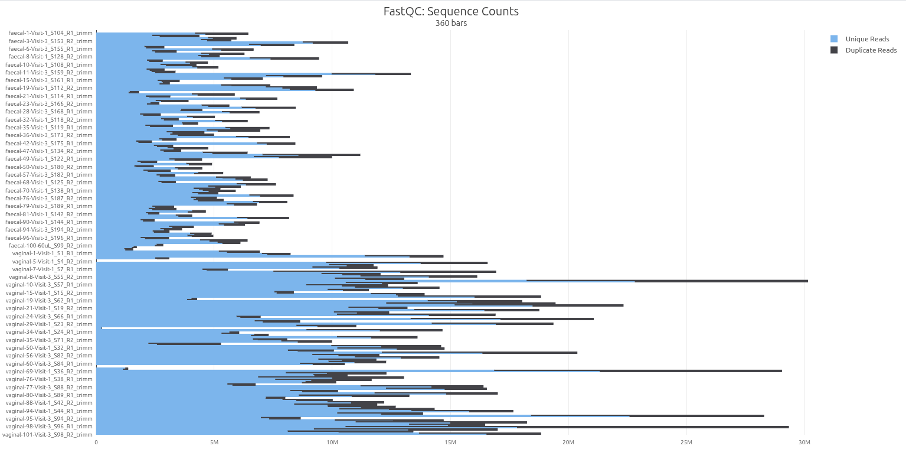
```

Do the per-base sequence composition plots look stable? Overall plot should be homogeneous-grey...

```{r eval=TRUE, post_trim_basequal, echo=FALSE, fig.cap="trimmed samples", out.width = '90%'}
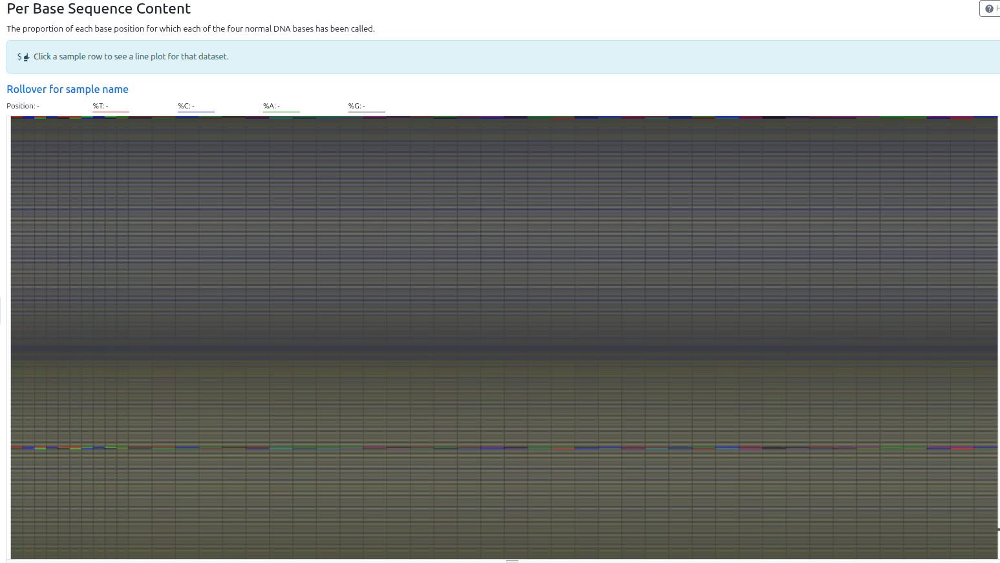
```

But make sure to click into a few sequences: 

```{r eval=TRUE, post_trim_basequal_faec, echo=FALSE, fig.cap="a trimmed faceal sample", out.width = '90%'}
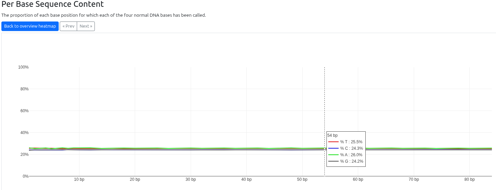
```

```{r eval=TRUE, post_trim_basequal_vag, echo=FALSE, fig.cap="a trimmed vaginal sample", out.width = '90%'}
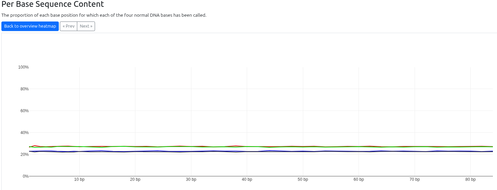
```

And check for the absence of adapters:

```{r eval=TRUE, post_tri_adapters, echo=FALSE, fig.cap="trimmed and filtered adapters", out.width = '90%'}
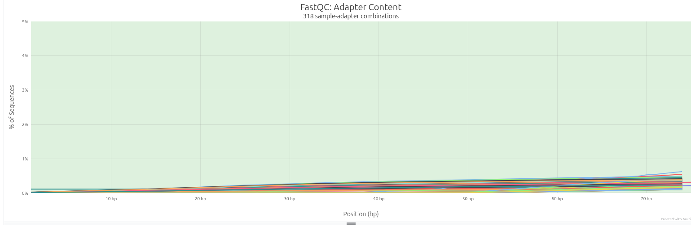
```

Possibly run `catcher` over it also:
```{bash re-catch-filt-qc}
catcher $qc/${proj}__filt

# bunch of failures due to truncated outputs from trimmomatic - rerun Trimmomatic on these samples only
for rr in $( catcher $qc/${proj}_filt );
do
  sbatch $mat/${proj}__slurm__trimmo4.sh $rr $join $filt ; 
done 

# fqc just those samples?...
catcher $qc/${proj}_filt | parallel -j 6 \
  fastqc -t 2 $filt/{}_R*_trimm.fastq.gz -o $qc/${proj}_filt
done 

multiqc $qc/${proj}_filt -o $qc/${proj}_filt_multi

```

Check it again! Keep solving until the problem is resolved.

<details>

<br> 

<!-- ## 3. remove host sequences (& check) - `Deacon` -->

<!--   > note: we decide *not* to rely on deacon for initial deconatmination.  -->

<!-- [`Deacon`](https://github.com/bede/deacon) is a powerful, fast decontamination programme that focuses on using "minimisers" (rare/unusual DNA patterns related to _k-mers_) to detect contaminant (host and bacterial) DNA sequences. Future work should include developing a better suited database to catch possible contaminants.  -->
<!-- Consider also doubling up with an alignment-based method also (e.g. `bowtie2`), depending on output - even if only for evaluation's sake. -->

<!-- ```{bash decontam} -->
<!-- # downloaded the correct (human) index when we installed... -->

<!-- ## tester set: -->
<!-- # time cat $mat/${proj}__tester.txt | parallel -j 8 "deacon filter -d \ -->

<!-- # ~15mins -->
<!-- time cat $mat/${proj}__samples.txt | parallel -j 8 "deacon filter -d \ -->
<!--   $db/deacon_db/panhuman-1.k31w15.idx \ -->
<!--   $filt/{}_R1_trimm.fastq.gz \ -->
<!--   $filt/{}_R2_trimm.fastq.gz \ -->
<!--   -o $host/{}_R1_deco.fastq.gz \ -->
<!--   -O $host/{}_R2_deco.fastq.gz \ -->
<!--   --threads 4 > $host/{}_hostless.log 2>&1" -->

<!-- ``` -->

<!-- <details> -->
<!-- <summary> `SLURM` version of `deacon` </summary> -->

<!-- Write the `SLURM` script: ` nano $mat/${proj}__slurm__deacon6.sh ` -->

<!-- ```{bash slurm_deacon } -->
<!-- #!/bin/bash -->

<!-- #SBATCH --job-name=deacon6 -->
<!-- #SBATCH --partition=cpuq-long -->
<!-- #SBATCH --output=omm__3__deacon6.%j.slrm -->
<!-- #SBATCH --ntasks=6 -->

<!-- sl_samp=$1 -->
<!-- sl_indir=$2 -->
<!-- sl_outdir=$3 -->

<!-- source /home/EXT05188/bin/miniforge3/etc/profile.d/conda.sh -->
<!-- conda activate geno -->

<!-- deacon filter -d \ -->
<!--   $db/deacon_db/panhuman-1.k31w15.idx \ -->
<!--   $sl_indir/${sl_samp}_R1_trimm.fastq.gz \ -->
<!--   $sl_indir/${sl_samp}_R2_trimm.fastq.gz \ -->
<!--   -o $sl_outdir/${sl_samp}_R1_deco.fastq.gz \ -->
<!--   -O $sl_outdir/${sl_samp}_R2_deco.fastq.gz \ -->
<!--   --threads 6 > $sl_outdir/${sl_samp}_hostless.log 2>&1 -->

<!-- ``` -->


<!-- Run the `SLURM` script: -->

<!-- ```{bash sbatch_slurm} -->

<!-- # for f in $( cat $mat/${proj}__samples.txt ) ;  -->
<!-- for f in $( cat $mat/${proj}__tester.txt | head -4 ) ;  -->
<!-- do  -->
<!--   sbatch $mat/${proj}__slurm__deacon6.sh $f $filt $host ;  -->
<!-- done -->


<!-- ``` -->

<!-- </details> -->

<!-- <br> -->

<!-- Again, it's crucial that we check what we've done. A quick test is likely to show that we keep (nearly) all of the gut stuff, and loose (nearly) all of the vaginal stuff: -->

<!-- ```{bash } -->
<!-- # very quick check of outputs -->
<!-- grep -h "Retained" $host/*log -->

<!-- ## oof! keep ~95% gut, keep 3-5% vaginal -->

<!-- # need to see how that looks for the sequences  - FQC/ MQC  -->
<!-- sbatch $mat/${proj}__slurm__fqc20.sh $host $qc/host 20 -->

<!-- ``` -->

<!-- <details> -->
<!-- <summary> in case `slurm` and `FQC-MQC` aren't communicating... </summary>  -->

<!-- Note we split out the L / R samples for consideration separately: -->

<!-- ```{bash qc_host_removal } -->
<!-- fastqc -q -t 16 $host/*_deco.fastq.gz -o $qc/${proj}_host ; multiqc $qc/${proj}_host -o $qc/${proj}_host_multi -->
<!-- ``` -->

<!-- </details> -->

<!-- <br> -->

<!-- And bring it back home for a look: -->

<!-- ```{bash copy_host_removal } -->
<!-- # enter this on your session with the terminal, so that the variables fill it out for you -->
<!-- echo "scp -o ProxyJump=${self}@garrison.ucc.ie ${self}@XXX.YYY.34.1:$qc/${proj}_host_multi/multiqc_report.html ./Desktop/" -->
<!-- ``` -->

<!-- **Generally less than 1M reads per vaginal sample**. Sometimes, removing huge amounts of host sequence data can reveal big problems with the underlying microbial data (the part you might care about). In this case, the _total_ adapter content increased a little (1%?), but overall things look decent. -->

<!-- ```{r eval=TRUE, post_host_adapter_content, echo=FALSE, fig.cap="whats left of the adapters, in whats left of the reads", out.width = '90%'} -->
<!-- 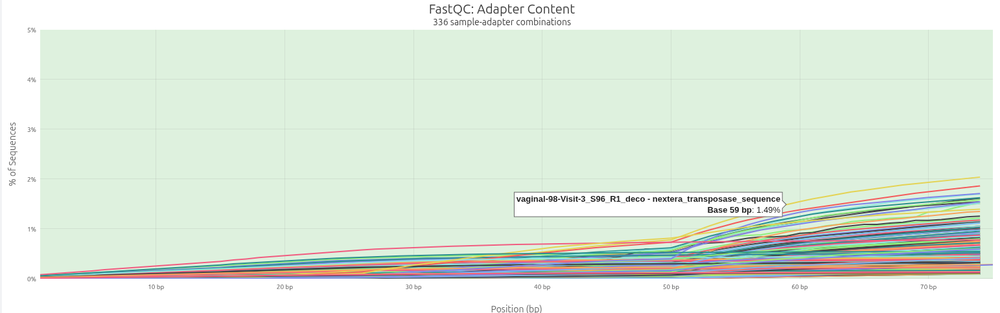 -->
<!-- ``` -->


<!-- <br>  -->

<br>

                        <!-- ## 3. remove host sequences (& check) - `Bowtie2` and the `T2T` human genome reference  -->
                        
                        <!-- Prof. Ben Langmead's [`BowTie2`](https://github.com/bede/deacon) is "a fast aand sensitive gapped read aligner", particularly well-suited to matching short reads (i.e. up to `~1000bp` ) to large reference sequences.  -->
                        
                        <!-- ```{bash decontam} -->
                        <!-- # we downloaded an updated human and 'decoy' reference sequence. -->
                        
                        <!-- ## tester set: -->
                        <!-- # time cat $mat/${proj}__tester.txt | parallel -j 8 "deacon filter -d \ -->
                        
                        <!-- # ~15mins -->
                        <!-- time cat $mat/${proj}__samples.txt | parallel -j 8 "deacon filter -d \ -->
                        <!--   $db/deacon_db/panhuman-1.k31w15.idx \ -->
                        <!--   $filt/{}_R1_trimm.fastq.gz \ -->
                        <!--   $filt/{}_R2_trimm.fastq.gz \ -->
                        <!--   -o $host/{}_R1_deco.fastq.gz \ -->
                        <!--   -O $host/{}_R2_deco.fastq.gz \ -->
                        <!--   --threads 4 > $host/{}_hostless.log 2>&1" -->
                        
                        <!-- ``` -->
                        
                        <!-- <details> -->
                        <!-- <summary> `SLURM` version of `deacon` </summary> -->
                        
                        <!-- Write the `SLURM` script: ` nano $mat/${proj}__slurm__deacon6.sh ` -->
                        
                        <!-- ```{bash slurm_deacon } -->
                        <!-- #!/bin/bash -->
                        
                        <!-- #SBATCH --job-name=deacon6 -->
                        <!-- #SBATCH --partition=cpuq-long -->
                        <!-- #SBATCH --output=omm__3__deacon6.%j.slrm -->
                        <!-- #SBATCH --ntasks=6 -->
                        
                        <!-- sl_samp=$1 -->
                        <!-- sl_indir=$2 -->
                        <!-- sl_outdir=$3 -->
                        
                        <!-- source /home/EXT05188/bin/miniforge3/etc/profile.d/conda.sh -->
                        <!-- conda activate geno -->
                        
                        <!-- deacon filter -d \ -->
                        <!--   $db/deacon_db/panhuman-1.k31w15.idx \ -->
                        <!--   $sl_indir/${sl_samp}_R1_trimm.fastq.gz \ -->
                        <!--   $sl_indir/${sl_samp}_R2_trimm.fastq.gz \ -->
                        <!--   -o $sl_outdir/${sl_samp}_R1_deco.fastq.gz \ -->
                        <!--   -O $sl_outdir/${sl_samp}_R2_deco.fastq.gz \ -->
                        <!--   --threads 6 > $sl_outdir/${sl_samp}_hostless.log 2>&1 -->
                        
                        <!-- ``` -->
                        
                        
                        <!-- Run the `SLURM` script: -->
                        
                        <!-- ```{bash sbatch_slurm} -->
                        
                        <!-- # for f in $( cat $mat/${proj}__samples.txt ) ;  -->
                        <!-- for f in $( cat $mat/${proj}__tester.txt | head -4 ) ;  -->
                        <!-- do  -->
                        <!--   sbatch $mat/${proj}__slurm__deacon6.sh $f $filt $host ;  -->
                        <!-- done -->
                        
                        
                        <!-- ``` -->
                        
                        <!-- </details> -->
                        
                        <!-- <br> -->
                        
                        <!-- Again, it's crucial that we check what we've done. A quick test is likely to show that we keep (nearly) all of the gut stuff, and loose (nearly) all of the vaginal stuff: -->
                        
                        <!-- ```{bash } -->
                        <!-- # very quick check of outputs -->
                        <!-- grep -h "Retained" $host/*log -->
                        
                        <!-- ## oof! keep ~95% gut, keep 3-5% vaginal -->
                        
                        <!-- # need to see how that looks for the sequences  - FQC/ MQC  -->
                        <!-- sbatch $mat/${proj}__slurm__fqc20.sh $host $qc/host 20 -->
                        
                        <!-- ``` -->
                        
                        <!-- <details> -->
                        <!-- <summary> in case `slurm` and `FQC-MQC` aren't communicating... </summary>  -->
                        
                        <!--   Note we split out the L / R samples for consideration separately: -->
                        
                        <!--   ```{bash qc_host_removal } -->
                        <!-- fastqc -q -t 16 $host/*_deco.fastq.gz -o $qc/${proj}_host ; multiqc $qc/${proj}_host -o $qc/${proj}_host_multi -->
                        <!-- ``` -->
                        
                        <!-- </details> -->
                        
                        <!--   <br> -->
                        
                        <!--   And bring it back home for a look: -->
                        
                        <!--   ```{bash copy_host_removal } -->
                        <!-- # enter this on your session with the terminal, so that the variables fill it out for you -->
                        <!-- echo "scp -o ProxyJump=${self}@garrison.ucc.ie ${self}@XXX.YYY.34.1:$qc/${proj}_host_multi/multiqc_report.html ./Desktop/" -->
                        <!-- ``` -->
                        
                        <!-- **Generally less than 1M reads per vaginal sample**. Sometimes, removing huge amounts of host sequence data can reveal big problems with the underlying microbial data (the part you might care about). In this case, the _total_ adapter content increased a little (1%?), but overall things look decent. -->
                        
                        <!-- ```{r eval=TRUE, post_host_adapter_content, echo=FALSE, fig.cap="whats left of the adapters, in whats left of the reads", out.width = '90%'} -->
                        <!--  -->
                        <!-- ``` -->


<br> 
  


## 4. identify - `Kraken2 + Bracken`

Previous steps have been very clear in their objective. For `#4`, need to have a think about what is required or sensible for your own project - more interested in specifics (genomes) or in communities (metagenomes)? Genes more than taxa (pathway analysis)?  

Below, we **presume metagenomics is the main interest**, and that we want something powerful and quick (and good). Like `Deacon`, [`Kraken2`](https://github.com/DerrickWood/kraken2/blob/master/docs/MANUAL.markdown) looks for unique sub-sequences (i.e _k-mers_) of DNA in our reads, and checks what species are known to have that pattern in their genomes.

However, `Kraken2` is _only_ designed to find a "best match" for each sequence. Applying statistics to this data directly is prone to errors, so `Bracken` estimates what the total community probably looked like, based on the output that `Kraken2` gives ([see here](https://www.nature.com/articles/s41596-022-00738-y) for more detail). The output will be an abundance feature table of `taxa x samples`. 

<br>

### Notes on Kraken2 

As Kraken2 databases _can_ be very large (>100GB), putting all of this data into RAM can be a huge overhead - especially if doing so multiple times. There are options in `Kraken2` (use `--memory-mapping`) and in `linux` (see copying the DB directly to `/temp/shm`) to work around this. There are also smaller databases that can be used - see [here](https://github.com/DerrickWood/kraken2/wiki/Manual#standard-kraken-2-database) and [here](https://benlangmead.github.io/aws-indexes/k2). 

<br>

**Note:** you'll need to have made (or downloaded) matching databases for `Kraken2` and `Bracken`, as well as downloading `KrakenTools` from github - see the `programmes` drop-down box earlier in this document for more details.

```{bash }
# activate the conda env with kraken2 and bracken installed
mamba activate k2

## check variables:
kr_db=$db/kraken2_plusPF_langmead
kr_threads=5
br_r=100      # $br_leng = match the post-host length
br_l=S
br_t=50   # counts of microbes! not threads


## apply for use with --memory-mapping, to avoid OOM
vmtouch -t  $kr_db/*.k2d


##  Kraken2  -------------------------------------------------------------

## could prb mem-map all samples in on ego, then parallel bracken 
## ~~skip the loop altogether~~ can define outputs via glob, mixes samples. 
## avoiding these outputs, as we rarely look at them.
#  --unclassified-out $krak/${test}_kraken_unclass# \
#  --output $krak/${test}_kraken_output  

time for test in $(cat $mat/${proj}__samples.txt );
do

echo " + + +   Kraken2 on ${test} -  conf 0.1, min-hits 5, min-qual 20 (mem-mapp)"
kraken2 --db $kr_db \
  $host/${test}_R1_deco.fastq.gz \
  $host/${test}_R2_deco.fastq.gz \
  --paired \
  --threads $kr_threads \
  --confidence 0.1 \
  --memory-mapping \
  --gzip-compressed \
  --report-zero-counts \
  --minimum-hit-groups 5 \
  --minimum-base-quality 20 \
  --report $krak/${test}_kraken2_report \

done > $krak/k2__all_memmap.log 2>&1

  
##  Bracken  -------------------------------------------------------------
# bracken -d $kr_db/ -i $krak/${test}_kraken2_report -o $krak/${test}.bracken -r $br_r -l $br_l -t $br_t &&
parallel -j $kr_threads bracken -d $kr_db/ -i {} -o {}.bracken -r $br_r -l $br_l -t $br_t  ::: $krak/*kraken2_report > $krak/k2_br.log 2>&1 


## tidy - scraunch if necessary
parallel -j $kr_threads gzip {} ::: $krak/${test}* 


```


<details>
<summary> `SLURM` for `Kraken2/Bracken` - to do (but should be v similar to the above) </summary>

```{bash make_KrakBrack1}
nano $mat/${proj}__slurm__kraken2.sh
```

Given that `Kraken2` is oh-so-fast (3-10 minutes pre sample) these jobs _could_ instead be sent to the `cpuq-short` partition, a section of the HPC that has much more `RAM` but limits jobs to 4 hours: `#SBATCH partition=cpuq-short`. Only possible if that partition is available : check with `sinfo`.

script contains:

```{bash make_KrakBrack2}
#!/bin/bash

#SBATCH --job-name=kraken5
#SBATCH --output=omm__4__krak2-5.%j.slrm
#SBATCH --ntasks=5
#SBATCH --time=0-0:10:00

## #SBATCH --partition=cpuq-short

samp=$1 
inpath=$2
outpat=$3
kr_db=$4

# define here in case we tweak later
kr_threads=5

br_r=100      # $br_leng = match the post-host length
br_l=S
br_t=50   # counts of microbes! not threads


source /home/EXT05188/bin/miniforge3/etc/profile.d/conda.sh
conda activate k2

echo " + + +   Kraken2 on ${samp} -  conf 0.1, min-hits 5, min-qual 20; Bracken read:${br_r}, count:${br_t}"
kraken2 --db $kr_db \
    $inpath/${samp}_R1_deco.fastq.gz \
    $inpath/${samp}_R2_deco.fastq.gz \
    --paired \
    --threads $kr_threads \
    --confidence 0.1 \
    --gzip-compressed \
    --report-zero-counts \
    --minimum-hit-groups 5 \
    --minimum-base-quality 20 \
    --report $outpat/${samp}_kraken2_report \
    --unclassified-out $outpat/${samp}_kraken_unclass# \
    --output $outpat/${samp}_kraken_output
    
kr_stat=$?
if [ ! $kr_stat -eq 0 ];
then 
  echo " < ! >    sample ${samp} failed Kraken2 :: $kr_stat"
else 
  bracken -d $kr_db/ -i $outpat/${samp}_kraken2_report -o $outpat/${samp}.bracken -r $br_r -l $br_l -t $br_t &&
  echo " + + +   sample ${samp} completed Kraken2/Bracken"
fi

# need paralell in k2 env
parallel -j $kr_threads gzip {} ::: $outpat/${samp}*


```

Send to `SLURM`:

```{bash submit_KrakBrack }
## apply memory mapping (flag already in slurm script) to avoid OOM
vmtouch -t  $kr_db/*.k2d

# for fq in $( cat $mat/${proj}__samples.txt );
# for fq in $( catcher $krak );
for fq in $( cat $mat/${proj}__tester.txt );
do 
  sbatch $mat/${proj}__slurm__kraken2.sh $fq $host $krak $kr_db
done

```

</details>

<br> 


Turn one-output-per-sample into a single file with all of the outputs (like an excel table: Rows*Columns). We also take this chance to create a taxonomy table for all the entries, which will make exploring the data much easier.

Note these scripts can be found in the [`KrakenTools`](https://github.com/jenniferlu717/KrakenTools) repo from the excellent [Jennifer Lu](https://github.com/jenniferlu717) (author of `Bracken` and co-author of `Kraken2`) -  see the installation section above if you havent got them.

<!-- is there a better way to get taxonomy? -->

```{bash anneal_KrakBrack }
## in case you've forgotten, your bin and KrakenTools folder are here:
lk $b_path
lk $b_path/KrakenTools

## combine
$b_path/KrakenTools/combine_kreports.py -r $krak/*_bracken_species -o $krak/${proj}__kraken2_plusPF_abundances.tsv

## for the taxonomy file, we first convert to MPA format (its just useful)
$b_path/KrakenTools/kreport2mpa.py -r $krak/${proj}__kraken2_plusPF_abundances.tsv -o $krak/${proj}__${test}_kraken2_mpa

grep -h '|s_' $krak/${proj}__${test}_kraken2_mpa | cut -f 1 |   sort | uniq | sed 's/|/\t/g' > $krak/${proj}__kraken2_plusPF_taxonomy.tsv

## have a lük
less -S $krak/${proj}__kraken2_plusPF_taxonomy.tsv

```

<br>

##  exit stage left

A speedrun through a specific type of short-read shotgun processing is done (this was metagenomics). Analysis and exploration are the next steps, and these typically take place on a local computer. Lets save out our data into a single small(er) file:

```{bash exit_stage_squash}

mkdir $mat/${proj}_output

# qc outputs - for reference
cp -r $qc/*multi $mat/${proj}_output/

# kraken2 outputs - the actual data
cp $krak/${proj}__kraken2_plusPF_abundances.tsv $krak/${proj}__kraken2_plusPF_taxonomy.tsv $mat/${proj}_output/


# compress all that to a single gzipped archive file
tar -czvf ${mat}/${proj}_output.tar.gz ${mat}/${proj}_output

```

<br>

Getting outputs back to the desktop can be daunting, but there are a few ways of doing it (e.g. [`FileZilla`](https://filezilla-project.org/download.php?type=client), `MobaXterm`) - `scp` is a built in go-to. 

In your terminal, run the following: this will (should) print out the _full_ command with the correct names (again, using the `local variables` above):

```{bash exit_stage_left}
# dont forget to fix XXX.YYY to the correct address
echo "scp -oProxyJump=${self}@garrison.ucc.ie ${self}@XXX.YYY.34.1:${mat}/${proj}_output.tar.gz ~/Desktop/"
```

<br>

<details>
<summary> The command has a few parts, explained here:  </summary>

Copy this to `plaintext` if it helps read it:

```
<1>  ---< 2 >-------  ------------< 3 >------------------  ---------------< 4 >----------------------  ---< 5 >---
scp  -i .ssh/id_file  -oProxyJump=${self}@garrison.ucc.ie  ${self}@XXX.YYY.34.1:${mat}/${proj}.tar.gz  ~/Desktop/
```

  1. `scp`, or "secure copy" - a mix of `ssh` and `cp`
  2. ID file - your authentication key. Not always necessary
  3. proxy  -  all your connections are passing through this computer, for great security
  4. user+IP+path of the file being sent
  5. location file is going to (presume its on your local computer)

<br>

Because _4._ has the user+IP+path, and _5._ just has where the file is going, we can tell that this command is supposed to be run on your local computer (where the file will be going). **Copy and paste** the command above into a new terminal window on your _local_ computer (desktop, laptop, etc.):

</details>

<br>

```{bash to_local}
# run:
echo "scp -i .ssh/id_file -oProxyJump=${self}@garrison.ucc.ie ${self}@XXX.YYY.34.1:${mat}/${proj}_output.tar.gz ~/Desktop/"

## now, copy, paste, and run the command printed out above! 
## follow the instructions it gives you, or record the message if something goes wrong. 

## NB: you might need to replace $proj with the fancyname you picked for your project at the beginning
## as you might not have assigned that local variable on your local machine

# should be here (or just check your desktop)
~/Desktop/${proj}.tar.gz

# uncompress it again - first go to whereever the file is located :
cd ~/Desktop
tar -xzvf ~/Desktop/${proj}.tar.gz

# if its there, you could probably also double click it...

```


Hopefully this has allll magically worked, and you're ready to push this data into `R`/`excel`/`GraphPad` etc. Easy peasy.